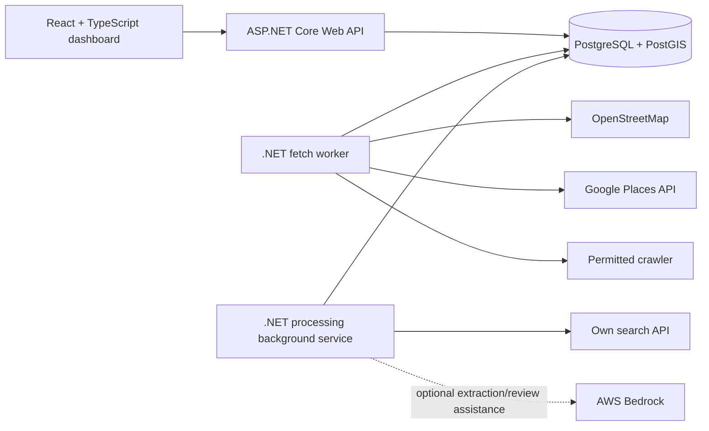

# LeadsFinder: MVP software requirements

Status: working product specification, 9 October 2026. The product decisions in this document reflect the current conversation. `Sales Lead App.txt` is an earlier brainstorming note; its alternative designs and numeric guesses are not binding requirements.

## 1. Product goal and scope

Build a portfolio application that discovers lodging businesses, cleans their details, and presents usable sales leads. The first supported category is **lodging**, including hotels, Airbnb-style accommodations, and bed-and-breakfasts. Keep the category model extensible, but implement only lodging in the MVP.

The first complete vertical slice is: create a scheduled search job, fetch places from a real source, retain raw observations in quarantine, process them into evidence-backed leads, and show the job and leads in a dashboard. A user should be able to request an admin correction when a lead is wrong.

### Users

- **User:** creates and monitors jobs, views cleaned leads, submits corrections.
- **Admin:** reviews uncertain duplicate matches and correction requests.

## 2. Functional requirements

| ID | MVP requirement |
| --- | --- |
| FR-01 | A user can create a search job with lodging subtype/place type; either city/state or center coordinates plus radius; required lead fields (phone, email, address); target lead count; shortage policy (`return fewer` or `expand radius`); and a scheduled UTC run time. |
| FR-02 | Validate inputs before queueing. A job has exactly one location mode. Coordinates and radius must be valid; target count and any radius expansion must be bounded. Exact product limits remain to be chosen. |
| FR-03 | Persist jobs with observable status, attempt count, timestamps, and errors. A worker claims due jobs from PostgreSQL and supports recovery after a crash. A job must not be considered successful until its source observations are committed. |
| FR-04 | Fetch through interchangeable strategies: OpenStreetMap, Google Places API, and a permitted website crawler. It is acceptable to deliver these one at a time. Record which strategy produced each observation. |
| FR-05 | Normalize every fetched observation into quarantine. Require a name, some address information, coordinates, strategy/source identity, and a source link. Preserve raw source data when useful for audit/debugging. Phone, email, website, and owner contacts are optional. |
| FR-06 | Before finalizing a quarantined observation, find nearby lead candidates using PostGIS (initial search radius approximately 50–100 m), plus exact-identifier candidates that may have imprecise coordinates. Normalize and compare name/aliases, distance, address components, phone, website, property type, and provider IDs. Use deterministic comparisons and calibrated matching rules for clear cases; do not merge solely because two hotels are close or share a phone, website domain, or GSTIN. |
| FR-07 | Merge clear duplicates **field by field**. A duplicate observation may fill missing or lower-quality lead fields; do not discard it merely because the business already exists. Keep a link between the lead and its source observations. Check that a new merge is consistent with the existing lead's other source records so pairwise matches cannot accidentally combine distinct neighboring properties. |
| FR-08 | Classify candidate pairs as clear match, clear non-match, or uncertain. For uncertain pairs, an optional low-cost model may compare the existing evidence; use a web-enabled model only when additional public evidence is needed. Require cited evidence for any model-assisted decision and send unresolved or conflicting cases to an admin review queue. A reviewer can decide whether to merge the observation with a lead or create a new lead. |
| FR-09 | Enrich missing fields using results returned by the application's own search API. AI may extract candidate values from those results and may assist with ambiguous matching. Every accepted value retains its source and confidence; unsupported claims are not accepted. AWS Bedrock is a candidate provider, not a prerequisite for the first vertical slice. |
| FR-10 | Store cleaned leads separately from quarantined observations. Preserve accepted field values and per-field provenance so users and admins can inspect why a value was chosen. |
| FR-11 | Expose API operations for creating/listing/viewing jobs and viewing leads. Expose admin operations for match reviews and correction requests. Restrict admin operations to admins. |
| FR-12 | Provide a React + TypeScript dashboard for job creation, job status/results, and lead viewing. Provide admin screens for uncertain matches and corrections. |
| FR-13 | A user can submit a correction request for an incorrect lead field or duplicate lead. An admin can review and apply or reject it, with an audit trail. |
| FR-14 | Report job outcome clearly: source counts, quarantined count, cleaned leads meeting required fields, and whether the target was met. Apply the selected shortage policy within a bounded search area. |

### Search and processing flow

1. The API validates a request and inserts a `pending` job with `ScheduledAtUtc`.
2. The fetch worker claims a due job. For the MVP, the `search_jobs` table is the durable queue; no separate queue product or scheduler service is required.
3. Strategies fetch places, normalize them, and persist source observations in quarantine. Provider errors and rate limits are recorded against the job.
4. A processing background service consumes unprocessed observations. It searches nearby leads, matches or sends ambiguous cases for review, enriches missing fields, records evidence, and saves cleaned leads.
5. The API exposes job progress and lead results to the dashboard. A job can finish with fewer than its target when the policy allows it.

The strategy adapter's normalized output is a source **observation**, not the final lead. Distinct sources may describe the same business; preserving those observations makes merging and provenance possible.

## 3. Proposed architecture and projects

| Project | State | Responsibility |
| --- | --- | --- |
| `LeadsFinder.Data` | Exists | EF Core `DbContext`, entity mappings, migrations, PostGIS/NetTopologySuite data access shared by API and workers. |
| `LeadsFinder.Worker` | Exists | Currently polls and runs demo fetch strategies. Evolve it to host a fetch background service and a separate quarantine-processing background service. One worker process is sufficient for the MVP. |
| `LeadsFinder.Api` | Planned | ASP.NET Core on .NET 10; job, lead, review, and correction endpoints; validation and authorization. |
| `LeadsFinder.Dashboard` | Planned | React + TypeScript UI. Vite is a reasonable project setup choice, not a product requirement. |
| `LeadsFinder.Tests` | Planned | Focused matching/unit tests and database-backed tests for claims, retries, spatial lookup, and merge behavior. Can be split by layer if needed. |

Keep business logic in testable services/classes. Add a separate core/application class library only when sharing domain rules across API and worker actually warrants it. The API and workers may directly reference `LeadsFinder.Data`; a database-management service is unnecessary. Keep provider-specific API calls inside strategy adapters.

## 4. Data model direction

**Existing tables:** `search_jobs` and `source_records`.

**Likely additions** (names are proposals, refine through vertical slices):

- `leads`: one internal `business_id` (UUID) per cleaned business; display name; business category; property type and property subtype; business status (`open`, `temporarily_closed`, `permanently_closed`, or `unknown`); coordinates; full and structured address (locality, city, district, state, postal code, country); primary business phone, email, and website; optional owner name and business-published owner phone; optional verified GSTIN; processing/review state; and flexible JSON key-value attributes for less common category-specific properties. Keep missing values null rather than inventing them. A property type can be hotel, guest house, homestay, etc.; the subtype adds finer detail when known.
- `lead_sources`: one row per contributing source record or source URL, including provider and external place ID when available. Do not store source links as a comma-separated string; one business and one field can have multiple sources.
- `lead_field_evidence`: one row per candidate field value with its field name, candidate/accepted value, source record or source URL, observed time, extraction method, acceptance decision, `confidence_level` (`high`, `medium`, or `low`), and `verification_status`. Preserve previous evidence when a field changes. Confidence is assessed per field and is distinct from verification: a high-confidence prediction is not automatically verified.
- `verified_fields`: a comma-separated list of canonical column names such as `address,phone,website`, exposed on the lead API and exports for convenient filtering/display. Derive it from accepted, verified `lead_field_evidence` rather than treating the string as the source of truth, so edits and corrections cannot leave it stale. Use stable internal field names rather than display labels.
- `match_reviews`: uncertain source-to-lead match, candidate(s), comparison signals, reviewer decision, timestamps.
- `correction_requests`: reporter, lead/field, proposed correction or duplicate report, evidence, status, admin decision.
- A processing state or queue marker for `source_records` so processing is resumable and idempotent.

Store geographic points with SRID 4326 using NetTopologySuite. Use PostGIS geography distance in meters and a GiST index for nearby candidate lookup. Keep source IDs scoped by strategy/provider; names alone are not unique IDs. Model job results explicitly enough to support target counts and progress.

For duplicate decisions, record the compared signals, decision method, match confidence, and any reviewer override separately from per-field value confidence. Start with explainable rules and fuzzy name/address similarity; calibrate auto-merge and review thresholds on labeled local hotel pairs before allowing automatic merges. Favor precision when merging because a false merge can corrupt several contact fields. Same provider and source ID identifies a repeated observation; different provider IDs do not by themselves prove different businesses.

## 5. Quality and operational requirements

- **Reliability:** job processing is at least once. Claiming and final commits must be safe under multiple worker instances and restarts. Bound retries; make source/lead writes idempotent. Do not promise exactly-once external fetching.
- **Evidence:** a contact detail or AI-extracted value must point to supporting source material. Confidence represents an assessed value with defined meaning, not a blanket score copied from a model.
- **Validation:** reject unusable source observations and record why. Normalize names, phone numbers, URLs, and addresses before comparison while preserving raw source values.
- **Observability:** structured logs include job ID, strategy, attempt, counts, and failure type. Expose status and useful errors through the API without leaking secrets.
- **Security:** keep provider keys and database credentials out of source control; authorize admin endpoints; treat fetched web text as untrusted data. Respect each provider's access terms, robots rules where applicable, rate limits, and attribution requirements.
- **Performance:** page API results; index job polling, geography, and source identity. Start with simple batches and measure before adding zone partitioning or caching.
- **Schema changes:** use EF Core migrations. In local development, apply them explicitly; application startup should not silently own production schema changes.

## 6. MVP acceptance criteria

1. A valid scheduled lodging job can be created from the dashboard and reaches `completed` or a visible `failed` state.
2. At least one real permitted source adapter returns normalized observations that appear in quarantine with source links.
3. An observation can become a cleaned lead; a clear duplicate enriches the existing lead field by field; an uncertain match becomes reviewable.
4. Accepted lead contact values have evidence and confidence. The app does not present unsupported AI output as verified data.
5. Users can view jobs and leads; admins can resolve a review and a correction request.
6. A restart or expired worker lease does not leave a job permanently stuck or allow a stale attempt to commit final job results. Focused tests cover these paths.

## 7. Later work and open decisions

**Later:** seen-lead tracking per user, sales activities/calls, customer lists, conversation history, searched-zone caching, popularity-based zone allocation, idle-time crawling, images/ratings/room types, other business categories, and larger-scale scheduling infrastructure. These ideas appear in `Sales Lead App.txt` but are not MVP dependencies.

**Decide during implementation:** exact coordinate/radius limits and expansion ceiling; city/state geocoding provider; first real source adapter and its permitted usage; confidence thresholds and review rules; authentication mechanism; how much of owner-contact enrichment is allowed and useful. Avoid hard-coding the old note's suggested `70%`/`80%` match thresholds as product rules without evaluating examples.
